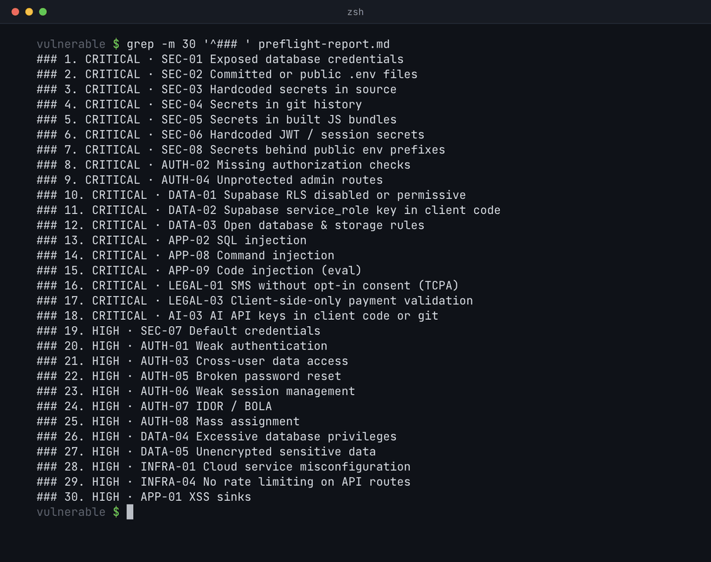

# preflight

The pre-launch checklist for vibe-coded apps. 69 checks, zero dependencies.

[](https://github.com/xploit007/preflight/stargazers) [](LICENSE)

A Claude Code plugin: install it, run `/scan` in your repo, and deterministic Node scripts find leaked keys, Supabase tables with RLS off, open admin routes, uncapped cloud and AI spend, and SMS sent without consent. Claude then checks the unclear hits and writes `preflight-report.md` with `file:line` evidence and a fix for each. It's the 30-second static scan you run before the heavy tools (Cloudflare's security-audit-skill, Strix).

The deterministic scan runs in seconds; Claude's full `/scan` review, adjudicating the unclear hits, takes a few minutes.



## Quick start

```bash
claude plugin marketplace add xploit007/preflight
claude plugin install preflight@preflight
```

Then start Claude Code (`claude`) in any repo and run:

```text
/scan
/scan --url https://your-app.com
/scan --supabase-url https://<project-ref>.supabase.co --supabase-key <anon-key>
```

Already inside Claude Code? The same install is `/plugin marketplace add xploit007/preflight`, then `/plugin install preflight@preflight`. If another plugin also has a `/scan`, use `/preflight:scan`.

Or install the agent skill, then ask your agent to run preflight (in Claude Code: `/preflight`):

```bash
npx skills add https://github.com/xploit007/preflight --skill preflight
```

Or run the scanner alone (exit code 1 on any critical finding):

```bash
git clone https://github.com/xploit007/preflight
node preflight/scripts/scan.js /path/to/your-app
```

## What it checks

- **Secrets (8):** keys in source, git history and bundles, committed `.env` files, public env prefixes.
- **Auth & sessions (12):** missing auth checks, open admin routes, IDOR, broken password resets, insecure cookies, no 2FA, weak password rules.
- **Database (7):** Supabase RLS off, the service-role key in browser code, open Firebase rules.
- **Costs & infra (5):** no rate limits, no spend caps, unbounded serverless runs, DDoS bandwidth bills.
- **Injection & app security (19):** XSS, SQL and NoSQL injection, SSRF, unsigned webhooks, permissive CORS, missing headers.
- **Legal (11):** privacy pages, cookie consent, unsubscribe links, SMS consent (TCPA), ADA basics, kids' data, dark patterns, prices set in the browser.
- **Dependencies (3):** known-vulnerable packages, missing lockfiles, typosquatted names.
- **AI keys (4):** AI keys in client code or git, prompt injection, unpermissioned tools, uncapped LLM spend.

All 69 checks with their fixes: [checklist.md](skills/preflight/references/checklist.md). Flags, output format and suppressions: [docs/usage.md](docs/usage.md).

## Example finding

```text
✖ FAIL    critical  SEC-03    Hardcoded secrets in source
            · Dockerfile:6 — Stripe live secret key (committed): ENV STRIPE_SECRET_KEY=sk_live_51…00
            · server/payments.js:3 — Stripe live secret key (committed): const stripe = Stripe('sk_live_51…00');
            · src/lib/ai.js:3 — OpenAI API key (committed): const openai = new OpenAI({ apiKey: 'sk-proj-Pr…00', dangerouslyAllowBrowser: true });
            → Revoke and reissue each key in the provider's dashboard first.
```

Real output from the demo scan of [`fixtures/vulnerable`](fixtures/vulnerable); preflight masks every secret it prints.

## How it's different

| | What it does | Needs |
| --- | --- | --- |
| **preflight** | 69 deterministic pre-launch checks in seconds, including non-code risks (spend caps, SMS consent, accessibility) | Node 18+ |
| [Cloudflare security-audit-skill](https://github.com/cloudflare/security-audit-skill) | Deep, adversarial vulnerability hunting in code, every finding independently verified | A coding agent and a multi-phase audit |
| [Strix](https://github.com/usestrix/strix) | Live agentic pentesting of your running app, with working proofs of concept | Docker and an LLM API key |

Run preflight before every launch; reach for the others when you need depth.

## Requirements

Node 18+, nothing else.

## License

MIT. See [LICENSE](LICENSE).
